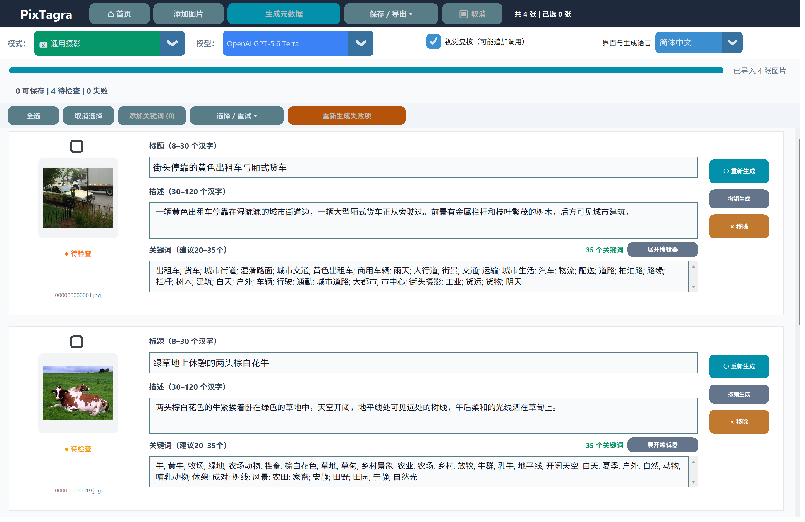
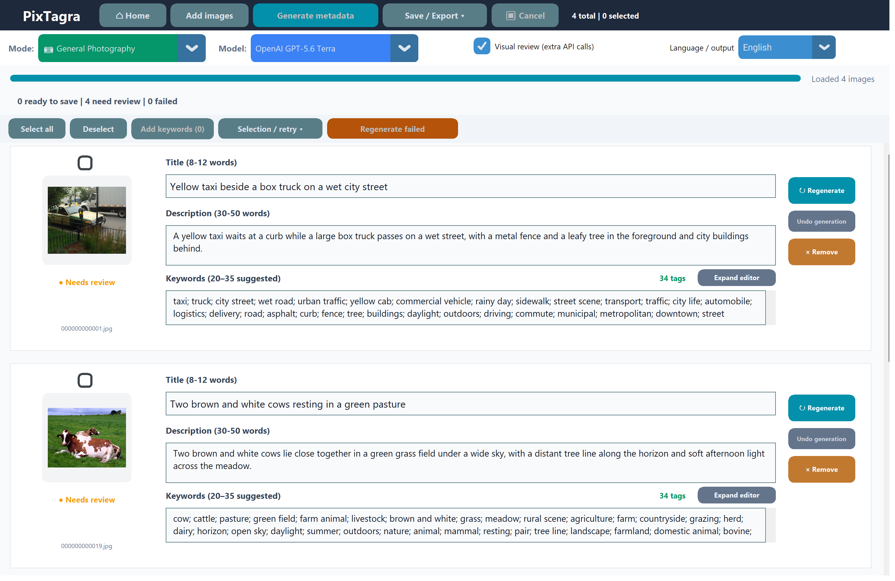

# PixTagra

Windows 桌面工具，用于生成、复核、编辑并导出图库图片的元数据——标题、描述和关键词——面向 Getty、Shutterstock、Adobe Stock 和 iStock。支持英文与简体中文，图片在本机处理。

A Windows desktop tool for generating, reviewing, editing and exporting stock-photo metadata — title, description and keywords — for Getty, Shutterstock, Adobe Stock and iStock. English and Simplified Chinese, with images processed locally.

## 界面 / Screenshots





## 使用说明 / User guides

- [中文使用说明](docs/user-guide/PixTagra-使用说明-中文.md) · [中文可打印版](docs/user-guide/PixTagra-使用说明-中文.html)
- [English user guide](docs/user-guide/PixTagra-User-Guide-English.md) · [English printable guide](docs/user-guide/PixTagra-User-Guide-English.html)

可打印版用浏览器打开后可另存为 PDF。

## 下载 / Download

从 [Releases](../../releases) 获取最新版本：

- `PixTagra-*-setup-x64.exe` — 安装程序，按用户安装到 `%LOCALAPPDATA%\Programs\PixTagra`，不需要管理员权限。
- `PixTagra-*-windows-x64.zip` — 便携版，解压后保持整个文件夹完整再运行。
- `PixTagra-release-identity.json` — 该次发布的源提交与各文件哈希，可用于核对下载内容。

需要 64 位 Windows 10 或 11。

## 基本流程

1. 启动 PixTagra，选择模型（云端服务商或本地 Ollama）。
2. 填入你自己的 API 密钥，或配置本地 Ollama 地址。
3. 先执行连接测试，确认端点可用。
4. 导入图片，查看生成的标题、描述和关键词，必要时给多张图批量添加相同关键词。
5. 处理标记为"待检查"的记录，再写出元数据或导出 CSV/JSON。

## 用户数据与 API 密钥

- API 密钥由你自己提供，调用费用直接支付给服务商。
- 除发送给你选择的服务商之外，图片始终保存在本机。
- 工作区恢复记录保存图片路径、文件标识、元数据、选择状态和生成阶段，**不保存图片字节，也不保存密钥**。
- 只有你明确选择持久化存储时，才会使用 Windows 凭据管理器和 Windows Hello。

## 重要限制

- 模型输出是草稿，不能保证被任何图库平台接受。
- 服务商可用性、模型 ID、限额和价格都会变化，以官方文档为准。
- 已到达服务商的取消请求仍可能产生费用；PixTagra 只停止发送新任务，并保留已返回的结果。
- 内置数量检查与视觉复核是辅助手段，不能替代人工核对。

## 许可 / License

[MIT License](LICENSE)。你可以自由使用、修改和分发，包括商业用途，只需保留版权声明和许可证文本。

第三方组件（Python、CustomTkinter、Pillow、cryptography 等）适用各自许可证。

## 支持 / Support

免费提供，欢迎通过 Issue 报告问题。打赏完全自愿，不对应任何服务承诺。
问题反馈邮箱：neravenn@gmail.com

## 开发 / Development

```powershell
python -m pip install -r requirements.txt
python -m py_compile pixtagra.py pixtagra_models.py
python -m pytest -q -p no:cacheprovider
```

受控 Windows 构建使用 `requirements-build.txt` 中固定的依赖版本和 `PixTagra.spec`：

```powershell
pwsh -File scripts/build_windows_rc.ps1 -BuildId A
pwsh -File scripts/verify_windows_rc.ps1 -ArtifactRoot dist/build-a/PixTagra -BuildId A
pwsh -File scripts/package_windows_rc.ps1 -ArtifactRoot dist/build-a/PixTagra -SourceCommit <commit> -VerificationReport .build-rc/verify-A/verification.json
```

代码签名流程见 [docs/developer/code-signing.md](docs/developer/code-signing.md)。
